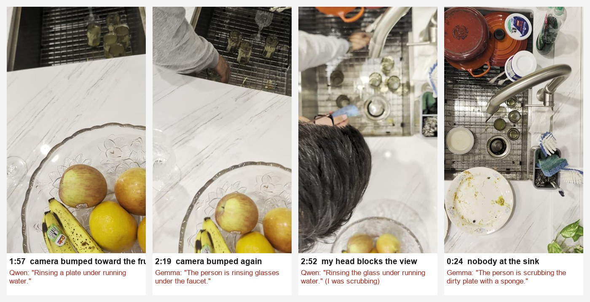

# Two free AI models label me washing dishes. Here's where they fail.

I filmed myself doing dishes for 3 minutes 37 seconds, with the phone propped above the sink. Then I had two free
vision models label every 4 seconds of it, scored each window against an answer key, and went looking for the
failure modes.

Everything ran on my own RTX 4090 through Ollama. Total cost: $0.



## What I found

**1. Neither model noticed when the sink was out of view.** I bumped the phone toward the fruit bowl twice, and once my head
blocked the shot. Both models kept describing dishwashing right through it. At 1:57 the camera is pointed at a
fruit bowl and Qwen says "Rinsing a plate under running water."

**2. On this video, the bigger model did worse.** Gemma 3 27B is more than three times the size of Qwen 2.5-VL 7B. It
scored lower, took twice as long, and described scrubbing or rinsing in 7 windows the answer key marks as a pause.

**3. A separate one-frame check catches problem 1 on this video.** It looks at one frame at a time and only asks whether the sink is
in view, and whether a head is covering it. It flagged at least one second of each of the 3 problems. My first wording raised
21 false alarms, because it read the faucet arching over the sink as "sink not visible." The second wording raised
0. But I wrote that second wording while looking at this same video. So it still needs a test on footage it hasn't seen.

**4. Where the two models disagree is where the mistakes are.** They disagreed on 27 of 55 windows. Together with the
view check, that flags 28 windows for a person to look at. That's half the video, and it holds 10 of Qwen's 11
mistakes. The one it misses is at 2:48, where both models said "bowl" for a glass. Same mistake twice, so no disagreement to catch it.

## Scores

Each 4-second window scores 0 to 3. One point for the right action, one for the right object, one for getting the
view check right (sink out of view, or blocked).

| | Qwen 2.5-VL 7B | Gemma 3 27B |
|---|---|---|
| Points | **146 / 165** | 129 / 165 |
| Windows fully right | **44 / 55** | 32 / 55 |
| View problems caught | 0 / 3 | 0 / 3 |
| Time to label 3:37 of video | **93 s** | 180 s |

| One-frame view check (Qwen) | First wording | Second wording |
|---|---|---|
| View problems flagged | 3 / 3 | 3 / 3 |
| False alarms (seconds) | 21 | **0** |
| Time for 217 frames | 92 s | 86 s |

## How it works

1. `frames/` holds one frame per second, 217 in all.
2. `gt.json` is the answer key. 13 steps with start and end times, plus the 3 view problems. It was checked against
   the video one frame per second.
3. `label.py` sends 4 frames at a time to a local model. The model has to pick an action (rinse, scrub, apply soap,
   pick up, put down, idle, camera off) and an object (bowl, plate, glass, utensil, sponge, none). It also writes one
   sentence and answers three quality questions. A fixed list means the score is a plain match, with no second AI
   doing the grading.
4. `score.py` compares each window to the answer key. The key was drawn at about 2-second precision, so a label counts
   if it matches any step inside its window.
5. `qc_gate.py` is the one-frame view check. Run it with `v1` or `v2` for the two wordings.
6. Every run is saved: `labels_*.json`, `score_*.json`, `qc_*.json`. Temperature 0, fixed seed.

```
python label.py qwen2.5vl:7b
python score.py labels_qwen2.5vl_7b.json
python qc_gate.py qwen2.5vl:7b v2
```

## Limits

One video, one person, one kitchen, one answer key. Half the video still goes to a person. So these numbers say
where to look next, not how the models do in general.

## What I'd do next

Run the view check first and drop the bad seconds before anything gets labeled. Then send only the windows where
the models disagree to a person. Then film five more chores the gate has never seen, and see if the second wording
still holds.

Raj Lakhani · rajanlakhani@gmail.com
